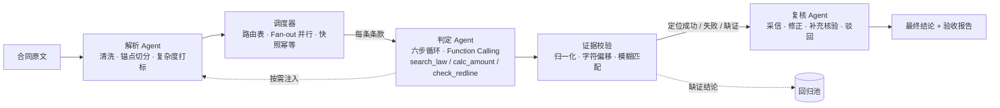

# 合同风险审查多 Agent 系统

面向商事合同的端到端风险条款审查系统：输入合同原文，输出结构化风险清单（条款片段 / 风险类型 / 等级 / 证据锚点），并提供证据定位、复核裁决与金标评测的完整闭环。

> 架构原则：**多 Agent 分工 + 自研编排**。解析、判定、复核三类职责拆分；编排、工具调用、评测均为自研实现，不依赖 LangChain 等框架。

## 架构



## 核心设计

| 模块 | 说明 |
|---|---|
| `parsing.py` | 行级清洗 + 正则锚点切分条款，LLM 只裁决边界（valid/merge/ignore），输出条款级偏移与复杂度标记（简单/复杂） |
| `judging.py` | 判定 Agent：带工具的多轮循环，动态轮次上限（简单 4 / 复杂 12），JSON 输出自纠偏，跨条款按需注入，每轮落快照可续跑 |
| `tools.py` | 自研 Function Calling：注册表 + 白名单校验 + 分发器，未注册工具直接拒绝；内置法条检索、金额核算、红线规则查询 |
| `evidence.py` | 证据定位：逐字符归一化 + 偏移映射，三级匹配（精确 find → 锚点定位 → 兜底粗扫），相似度 ≥0.85 判定位成功 |
| `reviewing.py` | 复核 Agent：拿到判定结论 + 证据相似度 + 锚点原文后四选一裁决；复核失败退回判定原文，结论不丢失 |
| `scheduler.py` | 自研调度器：条件路由表驱动（无 if 串联），Fan-out 并行（信号量），**故障恢复只重跑失败分支**——快照 FINISHED 即幂等跳过 |
| `db.py` | SQLite 快照底座（WAL + 事务）：全局上下文 / 条款 / 判定快照 / 复核快照 / 证据结果 / 回归池 / 运行归档 |
| `metrics.py` | 金标评测：字符区间 IoU / Precision / Recall，五档分流（命中 / 模糊 / 证据过宽 / 匹配冲突 / 漏检），金标坐标自动映射（raw→clean） |
| `server.py` + `web/` | FastAPI 服务 + 原生 JS 单页前端：风险清单、条款全览、任务快照、验收指标四个视图，证据锚点在原文抽屉中彩色高亮，无构建依赖 |

## 快速开始

```bash
pip install -r requirements.txt

# 设置模型密钥（DeepSeek，OpenAI 兼容接口）
set DEEPSEEK_API_KEY=sk-xxxx        # Windows
export DEEPSEEK_API_KEY=sk-xxxx     # Linux/macOS

# 启动服务（有密钥走真模型，无密钥自动降级离线模拟）
python server.py

# 或命令行跑批
python run_demo.py --fresh --contract rule/合同01_货物采购合同_陷阱测试稿.txt
```

浏览器打开 `http://127.0.0.1:8000/`，接口文档在 `/docs`。

无密钥时系统进入 **mock 模式**：整条流水线（解析 → 并行判定 → 证据校验 → 复核 → 评测）照常运转，结论由本地模拟生成，便于演示与联调。

## 评测体系

`python run_demo.py` 运行结束后输出验收报告，与 `final_gt/` 下的人工标注自动比对：

- **定位成功率**：证据在原文中锚定成功的比例
- **金标召回**（严格 / 含过宽）与**系统级精确率**
- **badcase 五档明细**：每条漏检 / 过宽 / 冲突样本附带 IoU、Precision、Recall 与原文片段，可直接归因到条款快照
- **成本观测**：单合同 token 消耗、端到端时长、故障恢复后的重跑范围

离线自测（零 API 费用）：

```bash
python tests/selftest.py   # 98 项断言：归一化映射、模糊匹配、切分组装、
                           # 调度器幂等、快照续跑、端到端模拟、金标评测五档
```

## 目录结构

```
├── config.py            # 全部阈值与模型配置集中于此
├── llm.py               # OpenAI 兼容客户端 + 令牌桶限流 + 单任务 token 熔断
├── db.py                # SQLite 快照底座
├── parsing.py / judging.py / reviewing.py / evidence.py   # 四个核心 Agent
├── tools.py             # Function Calling 工具层（data/laws.json 为法条数据）
├── scheduler.py / pipeline.py   # 编排层：路由表 + Fan-out + 快照幂等
├── metrics.py           # 金标评测与验收报告
├── server.py / web/     # FastAPI 服务与前端
├── run_demo.py          # 命令行跑批入口
├── inspect_db.py        # 快照与回归池排查工具
├── rule/                # 36 份商事合同样例
├── final_gt/            # 36 份人工标注金标（字符级偏移）
└── tests/selftest.py    # 离线自测
```

## 说明

- `data/laws.json` 为接口演示用的样例法条与红线规则；法条数据治理不在本项目范围内，正式使用由法务侧替换数据文件，Agent 代码无需改动。
- 任务注册表在服务进程内存中，需单 worker 运行；横向扩容时将注册表替换为 Redis 即可，接口形状不变。
